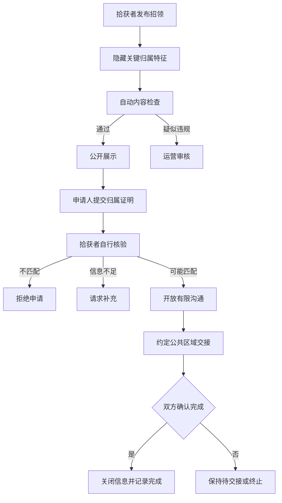
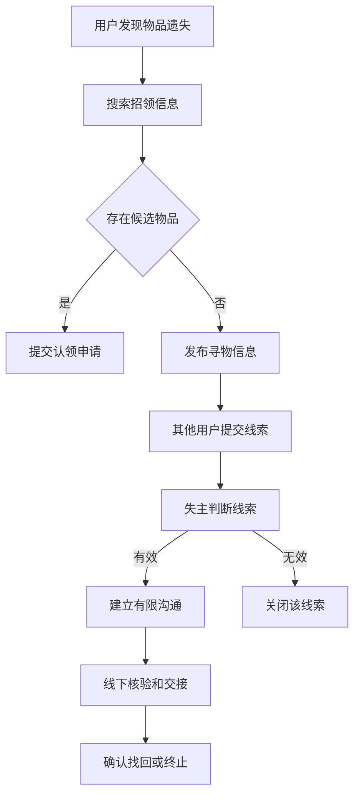

# 校园失物招领互助小程序 PRODUCT

> 文档版本：v0.1.0  
> 文档状态：产品与技术方案初稿  
> 更新日期：2026-11-09  
> 产品性质：非官方校园互助平台  
> 目标终端：微信小程序、运营管理 Web 端  
> 后端实现：Java 与 Python 两个功能等价的独立版本

---

## 0. AI 速读卡

- 产品定位：帮助校园及校园周边用户发布、检索、核验和交接遗失物品的非官方互助小程序。
- 核心用户：失主、拾获者、提供线索的普通用户、平台运营人员。
- 核心价值：降低信息分散造成的搜索成本，通过隐藏关键特征和结构化认领降低冒领风险。
- 产品边界：不提供校方身份认证，不代表学校，不判定物品所有权，不担保线下交接结果。
- MVP：微信登录、自报学校、寻物/招领发布、搜索筛选、认领申请、有限沟通、交接确认、举报拉黑、内容审核。
- 明确不做：支付悬赏、物流配送、公开联系方式、学生证认证、官方保管、平台信用背书。
- 后端要求：同一份 OpenAPI 和数据库逻辑模型，分别提供 Java/Spring Boot 与 Python/FastAPI 实现。
- 最大风险：冒领、诈骗、骚扰、隐私泄露以及用户误认为平台由校方运营。
- 核心原则：公开信息少披露、认领信息先证明、线下交接可随时终止、全流程留存必要审计记录。
- 当前待验证：校园用户真实需求、发布频率、认领完成率及用户对站内有限沟通的接受度。

---

## 1. 文档信息

### 1.1 修订记录

| 版本 | 日期 | 状态 | 修改内容 |
|---|---|---|---|
| v0.1.0 | 2026-11-09 | 初稿 | 完成非官方校园互助产品定义、MVP 需求和双后端实现约束 |

### 1.2 事实、假设与建议

| 类型 | 内容 |
|---|---|
| 已确认事实 | 学校暂不提供统一身份认证 |
| 已确认事实 | 保卫处或失物中心不参与物品认领与交接 |
| 已确认事实 | 产品初期不具备官方身份 |
| 合理假设 | 首期以单校或少量校园试点，但数据模型支持多校区 |
| 合理假设 | 使用微信小程序账户作为平台账户，不将其等同于校园身份 |
| 产品建议 | 首期不开放无约束即时聊天，优先使用认领申请和有限消息 |
| 产品建议 | 高价值物品、证件和银行卡应持续提示用户联系适当机构处理 |
| 待确认 | 首批试点学校、目标上线时间、运营审核人员及内容审核服务预算 |

---

## 2. 产品背景与问题定义

校园失物信息通常分散在班级群、校园群、表白墙、朋友圈等渠道。信息格式不统一、生命周期不清晰、关键内容可能过度公开，导致失主难以持续检索，拾获者也难以安全核验申请人的归属证明。

本产品提供统一的信息结构、搜索入口、认领流程和状态闭环，但不假设平台能够验证真实校园身份或判定物品所有权。

### 2.1 核心问题

1. 信息发布渠道分散，失主难以完整检索。
2. 信息缺少分类、时间、地点和状态等结构化字段。
3. 发布者可能公开过多特征，增加冒领风险。
4. 直接暴露微信号、手机号可能带来骚扰和诈骗。
5. 完成交接后缺少状态更新，过期信息长期存在。
6. 非官方平台容易被用户误认为具有身份或归属认证能力。

### 2.2 产品声明

所有关键入口应以简洁方式展示以下含义：

> 本平台是非官方校园互助工具，不代表学校或校方机构，不核验校园身份和物品所有权。用户应保护个人信息、拒绝陌生转账，并优先在人员较多的公共区域交接。

---

## 3. 产品目标与非目标

### 3.1 用户目标

- 拾获者能够在 2 分钟内完成一条结构化招领信息的发布。
- 失主能够通过关键词、分类、时间和区域快速找到候选物品。
- 申请人在不接触拾获者私密核验答案的前提下提交归属证明。
- 双方能够在平台内完成联系、交接和状态关闭。

### 3.2 建议指标

以下目标值均为产品建议，不是已经验证的业务事实：

| 指标 | 建议目标 | 统计口径 |
|---|---:|---|
| 有效发布完成率 | ≥ 80% | 开始发布后成功提交的信息数/开始发布次数 |
| 发布中位耗时 | ≤ 2 分钟 | 进入发布页至提交成功 |
| 搜索结果点击率 | ≥ 25% | 发生详情点击的搜索会话/全部搜索会话 |
| 认领申请有效率 | ≥ 40% | 被发布者接受或要求补充的申请/全部申请 |
| 双方确认完成率 | ≥ 25% | 双方确认完成的信息/展示中的信息 |
| 冒领或诈骗举报率 | ≤ 1% | 相关成立举报/全部认领申请 |
| 举报首次处理时间 | ≤ 24 小时 | 举报提交至首次运营处理 |

### 3.3 非目标

- 不为用户提供官方校园身份背书。
- 不代表学校、保卫处、宿管部门或失物中心。
- 不裁决物品所有权和线下纠纷。
- 不提供支付、悬赏、保证金、邮寄或跑腿交易。
- 不鼓励用户上传完整学生证、身份证或银行卡图像。
- 不以公开信用分制造虚假的安全感。

---

## 4. 用户角色

| 角色 | 核心任务 | 主要权限 |
|---|---|---|
| 失主 | 检索物品、发布寻物、申请认领、确认找回 | 管理自己的寻物信息和认领申请 |
| 拾获者 | 发布招领、核验申请、安排交接 | 管理自己的招领信息和收到的申请 |
| 线索提供者 | 向失主提供可能有用的信息 | 对展示中的信息提交线索 |
| 普通用户 | 浏览、搜索、收藏、举报 | 使用公开功能 |
| 运营管理员 | 审核内容、处理举报和违规账户 | 查看必要审计信息并执行管理动作 |

### 4.1 账户可信信息

平台只能展示可被系统客观记录的信息：

- 账号注册时间；
- 有效发布数量；
- 双方确认完成的互助次数；
- 是否存在生效中的违规限制；
- 用户自行填写的学校和校区。

禁止将自报学校、微信登录或手机号绑定展示为“校园认证”“身份可信”或“官方认证”。

---

## 5. 产品范围与优先级

### 5.1 MVP（P0）

| 模块 | 功能 |
|---|---|
| 账户 | 微信登录、用户协议确认、注销、风险提示确认 |
| 校园 | 用户自行选择或填写学校、校区；明确标记“用户自报” |
| 发布 | 发布寻物/招领、草稿、图片、分类、模糊时间和地点 |
| 发现 | 信息流、关键词搜索、分类/时间/校区/状态筛选、收藏 |
| 认领 | 认领申请、私密特征证明、补充信息、通过或拒绝 |
| 线索 | 用户向寻物信息提交线索、失主查看与关闭线索 |
| 沟通 | 结构化消息、必要文本留言、骚扰举报和拉黑 |
| 交接 | 待交接、双方确认、单方关闭、争议标记 |
| 安全 | 敏感信息提示、频率限制、举报、拉黑、审计日志 |
| 运营 | 内容审核、举报处理、下架、禁言、账号限制 |

### 5.2 后续版本（P1/P2）

- 图片和文本相似度匹配；
- 相似物品订阅提醒；
- 校园地图模糊区域选择；
- 多校区运营配置；
- 更完善的反垃圾和反诈骗模型；
- 数据分析与运营报表；
- 在学校正式合作后新增独立的官方接入能力，且不得与自报身份混淆。

### 5.3 明确排除

- 公开手机号或微信号；
- 公开完整学号、证件号、宿舍号；
- 上传密码、验证码或账户凭证；
- 平台代收、保管或配送物品；
- 未经值守人员同意，将物品放置于宿管、商户等位置；
- 自动判定申请人为真实失主。

---

## 6. 信息架构与页面

```text
首页
├── 搜索
├── 招领广场
├── 寻物广场
├── 分类入口
└── 相似信息推荐（后续）

发布
├── 我丢了物品
└── 我捡到物品

消息
├── 认领申请
├── 线索通知
├── 交接提醒
└── 系统通知

我的
├── 我的发布
├── 我的申请
├── 我的收藏
├── 自报学校与校区
├── 黑名单
├── 举报记录
└── 设置与注销
```

### 6.1 页面清单

| 页面 | 目标 | 核心操作 |
|---|---|---|
| 首次进入页 | 解释非官方定位和风险边界 | 同意协议、进入平台 |
| 首页 | 快速搜索和浏览近期信息 | 搜索、筛选、进入详情 |
| 信息广场 | 按条件发现候选信息 | 切换寻物/招领、排序、筛选 |
| 发布页 | 低成本创建结构化信息 | 保存草稿、预览、提交 |
| 物品详情 | 查看公开信息和当前状态 | 申请认领、提供线索、举报 |
| 认领申请页 | 提交不公开的归属证明 | 提交、补充、撤回 |
| 申请管理页 | 由发布者核验申请 | 请求补充、通过、拒绝、举报 |
| 沟通页 | 在受控范围内安排交接 | 结构化消息、文本留言、拉黑 |
| 交接确认页 | 记录双方确认结果 | 确认完成、终止、标记争议 |
| 我的发布 | 管理信息生命周期 | 编辑、关闭、延长有效期 |
| 运营后台 | 处理内容和用户风险 | 审核、下架、限制、记录结论 |

---

## 7. 核心业务流程

### 7.1 招领与认领



### 7.2 寻物与线索



---

## 8. 功能需求

### REQ-001 用户账户

- 用户通过微信小程序登录建立平台账户。
- 首次使用必须确认用户协议、隐私说明及非官方平台提示。
- 系统不得将微信账户描述为真实身份或校园身份认证。
- 用户可以修改昵称、头像、自报学校和校区。
- 用户可以申请注销；争议处理所必需的记录按照隐私规则保留。

验收标准：

- **GIVEN** 用户首次登录，**WHEN** 尚未确认协议，**THEN** 系统不得允许其发布、留言或认领。
- **GIVEN** 用户修改自报学校，**WHEN** 保存成功，**THEN** 页面必须显示“用户自报，未经校方认证”。
- **GIVEN** 账户处于限制状态，**WHEN** 用户执行受限操作，**THEN** 系统拒绝操作并说明限制范围和申诉入口。

### REQ-002 发布信息

必填字段：

- 类型：寻物或招领；
- 标题及物品分类；
- 大致时间；
- 学校、校区及模糊区域；
- 公开描述；
- 联系偏好；
- 至少一张图片，或选择无法提供图片的原因。

业务规则：

- 招领发布者必须额外填写至少一个不公开的核验特征。
- 系统提示用户遮挡证件号、人像、二维码、银行卡号等敏感内容。
- 公开地点不得精确到宿舍房间或个人固定座位。
- 发布者可以保存草稿、编辑、关闭或延长有效期。
- 已进入认领或争议流程的信息，关键字段修改必须记录审计事件。

### REQ-003 搜索与筛选

- 支持关键词、类型、分类、学校、校区、时间范围、区域和状态筛选。
- 支持最新发布和相关度排序。
- 搜索结果不得包含私密核验特征和申请内容。
- 默认不展示已关闭、已过期和已下架信息。

### REQ-004 认领申请

- 用户只能对展示中的招领信息提交认领申请。
- 申请包含大致遗失时间、地点、私密特征和可选证明图像。
- 同一用户对同一物品只能存在一个进行中的申请。
- 申请内容仅对申请人、发布者及必要的运营人员可见。
- 用户不得提交密码、验证码、支付凭证密钥等高风险信息。

验收标准：

- **GIVEN** 用户超过认领频率限制，**WHEN** 再次提交，**THEN** 系统拒绝请求且不泄露平台风控规则细节。
- **GIVEN** 申请被要求补充，**WHEN** 用户提交补充内容，**THEN** 原申请更新版本并保留必要操作记录。
- **GIVEN** 申请被拒绝，**WHEN** 用户查看结果，**THEN** 系统不得展示拾获者保存的私密答案。

### REQ-005 申请核验

- 发布者可以请求补充、通过、拒绝或举报申请。
- 平台不输出“认领人真实”或“归属验证成功”等结论。
- 申请通过后才能进入有限沟通和交接流程。
- 一条招领信息同一时间最多允许一个申请进入待交接状态。

### REQ-006 有限沟通

- 默认提供结构化消息：请求补充、建议时间、建议地点、迟到提醒、终止交接。
- 如开放文本留言，必须支持内容审核、举报和拉黑。
- 用户被拉黑后不得继续向对方发送消息或申请。
- 平台默认不公开双方手机号和微信号。

### REQ-007 交接确认

- 申请通过后，状态变为“待交接”。
- 交接页持续提示选择人员较多的公共区域、拒绝转账和保护隐私。
- 双方分别确认后，状态变为“双方确认完成”。
- 任一方可以终止交接并选择原因。
- 存在举报或争议时，记录不得由普通用户彻底删除。

### REQ-008 举报、拉黑与运营处理

- 用户可以举报信息、申请、消息或用户。
- 举报必须选择分类，并可提交说明和证据。
- 运营人员可以下架信息、限制功能、禁言或封禁账户。
- 每个管理动作必须记录操作者、原因、时间和影响范围。
- 被处理用户应看到可理解的结果和申诉入口，但不得获得会帮助绕过风控的细节。

### REQ-009 线索提供

- 用户只能对展示中的寻物信息提交线索。
- 线索包含文字说明，可选附一张图片。
- 线索仅对失主及必要的运营人员可见，不对外公开。
- 失主可以查看、标记有效、标记无效或关闭线索。
- 标记有效的线索可以进入有限沟通流程（复用 REQ-006）。
- 线索提交必须通过内容审核，并受频率限制约束。

验收标准：

- **GIVEN** 用户对招领信息提交线索，**WHEN** 提交，**THEN** 系统拒绝，因为线索仅适用于寻物信息。
- **GIVEN** 失主将线索标记无效，**WHEN** 保存，**THEN** 线索状态关闭且不再出现在待处理列表。
- **GIVEN** 线索内容被识别为骚扰或广告，**WHEN** 审核，**THEN** 系统拦截或转人工处理。

### REQ-010 收藏

- 用户可以收藏或取消收藏展示中的信息。
- 收藏仅对自己可见，支持在“我的收藏”中查看并跳转详情。
- 被收藏的信息下架、关闭或过期后，收藏仍保留但显示对应状态提示。
- 收藏操作是幂等切换，同一信息不会产生重复收藏记录。
- 收藏数量不对外展示，不进入账户可信信息。

验收标准：

- **GIVEN** 用户对已收藏信息再次点击收藏，**WHEN** 操作，**THEN** 取消收藏。
- **GIVEN** 被收藏信息被下架，**WHEN** 用户查看收藏列表，**THEN** 该条目标注“已下架”且无法进入详情。

---

## 9. 状态模型

### 9.1 信息状态

| 当前状态 | 事件 | 下一状态 |
|---|---|---|
| DRAFT | 用户提交 | PENDING_REVIEW |
| PENDING_REVIEW | 自动或人工通过 | PUBLISHED |
| PENDING_REVIEW | 审核拒绝 | REJECTED |
| PUBLISHED | 有申请进入核验 | VERIFYING |
| VERIFYING | 一个申请通过 | PENDING_HANDOVER |
| VERIFYING | 全部申请关闭 | PUBLISHED |
| PENDING_HANDOVER | 双方确认 | COMPLETED |
| PENDING_HANDOVER | 交接终止 | PUBLISHED 或 CLOSED |
| PUBLISHED | 发布者主动关闭 | CLOSED |
| PUBLISHED | 超过有效期 | EXPIRED |
| 任意公开状态 | 违规处理成立 | REMOVED |

### 9.2 认领申请状态

`SUBMITTED → NEEDS_MORE_INFO → ACCEPTED → PENDING_HANDOVER → COMPLETED`

其他终态：`REJECTED`、`WITHDRAWN`、`CANCELLED`、`BLOCKED_BY_MODERATION`。

状态迁移必须由服务端校验，不允许客户端任意指定目标状态。

### 9.3 线索状态

`SUBMITTED → ACCEPTED → CLOSED`

其他终态：`REJECTED`、`EXPIRED`（寻物信息关闭或过期时联动关闭）。

收藏为布尔型关系，无状态机；仅在取消收藏或信息下架时移除或隐藏。

---

## 10. 数据模型

逻辑数据模型对 Java 与 Python 实现保持一致。

| 实体 | 关键字段 |
|---|---|
| User | id、wechat_subject、nickname、avatar_url、status、created_at |
| CampusProfile | user_id、school_name、campus_name、self_declared、updated_at |
| ItemPost | id、author_id、type、category、title、public_description、occurred_from/to、school、campus、area、status、version |
| ItemImage | id、post_id、storage_key、sort_order、moderation_status |
| PrivateClue | id、post_id、encrypted_content、created_at |
| Claim | id、post_id、applicant_id、statement、status、version、created_at |
| ClaimEvidence | id、claim_id、storage_key、evidence_type、moderation_status |
| Clue | id、post_id、provider_id、content、storage_key、status、created_at |
| Message | id、conversation_id、sender_id、type、content、status、created_at |
| Handover | id、claim_id、proposer_id、time_window、public_place、owner_confirmed_at、claimant_confirmed_at、status |
| Report | id、reporter_id、target_type、target_id、reason、description、status |
| BlockRelation | blocker_id、blocked_id、created_at |
| Bookmark | user_id、post_id、created_at（联合唯一） |
| ModerationAction | id、operator_id、target_type、target_id、action、reason、created_at |
| AuditEvent | id、actor_id、event_type、target_type、target_id、metadata、created_at |

### 10.1 数据规则

- 主键建议使用 UUIDv7 或等价的不可预测标识。
- 所有时间统一以 UTC 存储，客户端按本地时区显示。
- 私密核验内容必须加密存储，且不得进入普通日志和搜索索引。
- 图片使用对象存储，数据库仅保存存储键及元数据。
- 业务记录采用软删除或状态关闭；敏感个人资料依据注销与保留策略处理。
- 使用乐观锁版本字段防止重复审核和并发状态覆盖。

### 10.2 私密数据加密与密钥管理

- 私密核验特征（PrivateClue）与认领证据（ClaimEvidence）采用应用层加密，建议使用 AES-256-GCM，密文随附算法与密钥版本标识。
- 主密钥由密钥管理服务（KMS）托管，不落库、不硬编码、不进入配置文件；数据库仅存密文。
- 支持密钥轮换：新数据使用新版本密钥，旧版本密钥保留到对应密文完成解密与迁移。
- 加密字段不得进入搜索索引、普通日志、埋点、缓存和分析系统。
- 若两个后端共用数据库，必须保持相同算法与密钥派生方式，确保密文可跨实现解密；若分别独立部署，可各自托管密钥，但算法与格式必须一致。

### 10.3 数据保留与注销策略

- 注销后账户立即失去登录与操作能力，状态置为注销。
- 个人可识别信息（昵称、头像、联系方式等）在注销后删除或匿名化；用户可申请导出或删除其数据。
- 涉及举报、争议、审计的记录按风险与法律要求保留，建议默认 6 个月，到期后匿名化或删除。
- 私密特征与认领证据在信息关闭或交接完成后，于保留期届满后删除密文。
- 上述期限为建议默认值，最终以法务确认及《个人信息保护法》等适用法规为准（见 §19）。

---

## 11. API契约

Java 与 Python 后端必须共同实现同一份 `openapi/product-api.yaml`。以下为核心资源建议：

| 方法 | 路径 | 用途 |
|---|---|---|
| POST | `/api/v1/session/wechat` | 微信登录或刷新平台会话 |
| GET/PATCH | `/api/v1/me` | 查询或更新当前用户 |
| GET/PUT | `/api/v1/me/campus-profile` | 管理自报学校信息 |
| POST | `/api/v1/posts` | 创建寻物或招领信息 |
| GET | `/api/v1/posts` | 搜索和筛选公开信息 |
| GET/PATCH | `/api/v1/posts/{postId}` | 查看或编辑信息 |
| POST | `/api/v1/posts/{postId}/publish` | 提交发布 |
| POST | `/api/v1/posts/{postId}/close` | 主动关闭 |
| POST | `/api/v1/posts/{postId}/claims` | 提交认领申请 |
| GET | `/api/v1/posts/{postId}/claims` | 发布者查看收到的申请 |
| POST | `/api/v1/claims/{claimId}/request-info` | 请求补充信息 |
| POST | `/api/v1/claims/{claimId}/accept` | 接受申请 |
| POST | `/api/v1/claims/{claimId}/reject` | 拒绝申请 |
| GET/POST | `/api/v1/conversations/{id}/messages` | 查询或发送有限消息 |
| POST | `/api/v1/handovers` | 创建交接安排 |
| POST | `/api/v1/handovers/{id}/confirm` | 当前用户确认完成 |
| POST | `/api/v1/handovers/{id}/cancel` | 终止交接 |
| POST | `/api/v1/reports` | 提交举报 |
| POST | `/api/v1/blocks` | 拉黑用户 |
| DELETE | `/api/v1/blocks/{userId}` | 解除拉黑 |
| POST | `/api/v1/posts/{postId}/clues` | 向寻物信息提交线索 |
| GET | `/api/v1/posts/{postId}/clues` | 失主查看收到的线索 |
| POST | `/api/v1/clues/{clueId}/decide` | 失主标记线索有效或无效 |
| POST | `/api/v1/posts/{postId}/bookmark` | 收藏信息 |
| DELETE | `/api/v1/posts/{postId}/bookmark` | 取消收藏 |
| GET | `/api/v1/me/bookmarks` | 查询我的收藏 |

### 11.1 统一响应与错误码

```json
{
  "data": {},
  "requestId": "0192...",
  "timestamp": "2026-11-09T08:00:00Z"
}
```

错误响应：

```json
{
  "error": {
    "code": "CLAIM_RATE_LIMITED",
    "message": "当前提交过于频繁，请稍后再试",
    "details": {}
  },
  "requestId": "0192...",
  "timestamp": "2026-11-09T08:00:00Z"
}
```

Java 与 Python 实现必须保持 HTTP 状态码、业务错误码、字段名称、分页格式和时间格式一致。

### 11.2 分页、时间与错误码规范

分页：列表接口统一使用 `page`（从 1 开始）与 `pageSize`（默认 20，最大 100）作为查询参数；列表响应在 `data` 中返回 `items` 与 `pagination` 对象：

```json
{
  "data": {
    "items": [],
    "pagination": { "page": 1, "pageSize": 20, "total": 0, "hasMore": false }
  },
  "requestId": "0192...",
  "timestamp": "2026-11-09T08:00:00Z"
}
```

时间：所有时间统一为 UTC，采用 RFC3339 格式（如 `2026-11-09T08:00:00Z`），存储与传输一致，客户端按本地时区展示。

错误码：两实现共用同一业务错误码表（见 `contracts/error-codes.yaml`），核心错误码约定如下：

| 错误码 | HTTP 状态 | 含义 |
|---|---|---|
| `AGREEMENT_NOT_ACCEPTED` | 403 | 未确认用户协议，禁止发布/留言/认领 |
| `SESSION_EXPIRED` | 401 | 会话过期或无效 |
| `ACCOUNT_RESTRICTED` | 403 | 账户处于限制状态 |
| `VALIDATION_FAILED` | 422 | 参数校验失败 |
| `RATE_LIMITED` | 429 | 触发频率限制 |
| `CLAIM_RATE_LIMITED` | 429 | 认领申请过于频繁 |
| `CLAIM_DUPLICATE` | 409 | 同一物品存在进行中的申请 |
| `HANDOVER_CONFLICT` | 409 | 已有申请进入待交接 |
| `INVALID_STATE_TRANSITION` | 409 | 非法状态迁移 |
| `POST_NOT_CLAIMABLE` | 409 | 信息当前不可申请认领 |
| `PRIVATE_CLUE_REQUIRED` | 422 | 招领缺少不公开核验特征 |
| `BLOCKED` | 403 | 已被对方拉黑 |
| `NOT_FOUND` | 404 | 资源不存在或无权访问 |
| `INTERNAL_ERROR` | 500 | 未预期的内部错误 |

### 11.3 微信小程序登录与订阅消息

登录：

- 小程序调用 `wx.login` 获取临时 `code`，通过 `POST /api/v1/session/wechat` 提交。
- 服务端使用 `code` 调用微信 `code2session` 换取 `openid`（及可用的 `unionid`）与 `session_key`；`session_key` 仅存服务端，绝不下发客户端。
- 平台会话以 `openid` 为 `wechat_subject` 主标识，采用服务端会话或 JWT；会话过期后重新走登录刷新。
- `unionid` 仅在跨小程序/公众号关联场景使用，不得将 `openid` 直接暴露为身份凭证。

订阅消息：

- 关键通知必须通过微信订阅消息发送，模板需在微信公众平台申请；正文只含必要信息，不得包含私密特征、联系方式或证件内容。
- 建议触发点：认领申请到达（通知拾获者）、申请被请求补充/通过/拒绝（通知申请人）、交接提醒、双方确认结果、举报处理结果。
- 每次发送前需用户授权（一次性订阅消息）；发送失败需记录并重试或降级为站内消息。

---

## 12. 双后端实现方案

### 12.1 共同约束

- 两个后端是可替换实现，生产环境按部署选择其中一个，不在同一请求链路中重复执行业务。
- OpenAPI、数据库迁移语义、状态机、错误码及契约测试是共同事实源。
- 两个实现不得共享运行时代码，但可以共享规范、测试向量、Docker Compose 和测试数据。
- 任一实现新增接口或状态时，必须先修改公共契约并通过兼容性评审。

建议仓库结构：

```text
project/
├── PRODUCT.md
├── openapi/
│   └── product-api.yaml
├── contracts/
│   ├── error-codes.yaml
│   ├── state-machines.yaml
│   └── test-vectors/
├── backend-java/
├── backend-python/
├── miniapp/
├── admin-web/
└── deploy/
```

### 12.2 Java实现

| 项目 | 选择 |
|---|---|
| 语言 | Java 21 LTS 或项目确定的受支持版本 |
| 框架 | Spring Boot 3.x |
| Web | Spring MVC |
| 数据访问 | Spring Data JPA；复杂查询可使用 jOOQ/MyBatis，需团队确认 |
| 安全 | Spring Security、JWT/服务端会话 |
| 校验 | Jakarta Bean Validation |
| 数据迁移 | Flyway |
| API文档 | springdoc-openapi，输出必须与公共 OpenAPI 对齐 |
| 测试 | JUnit 5、MockMvc、Testcontainers |
| 构建 | Maven 或 Gradle，仓库内统一一种 |

建议模块：

```text
backend-java/
├── src/main/java/.../account
├── src/main/java/.../listing
├── src/main/java/.../claim
├── src/main/java/.../messaging
├── src/main/java/.../handover
├── src/main/java/.../moderation
└── src/main/java/.../shared
```

### 12.3 Python实现

| 项目 | 选择 |
|---|---|
| 语言 | Python 3.12+ 或项目确定的受支持版本 |
| 框架 | FastAPI |
| 数据访问 | SQLAlchemy 2.x |
| 数据模型与校验 | Pydantic 2.x |
| 数据迁移 | Alembic |
| 身份与会话 | PyJWT/Authlib 或受控会话组件 |
| 异步任务 | 首期可使用进程内任务；生产异步任务建议 Celery/Dramatiq，按规模确认 |
| 测试 | pytest、HTTPX、Testcontainers |
| 依赖管理 | `pyproject.toml`，选择 uv/Poetry 等一种工具 |

建议模块：

```text
backend-python/
├── app/account
├── app/listing
├── app/claim
├── app/messaging
├── app/handover
├── app/moderation
└── app/shared
```

### 12.4 等价性验收

两个实现必须通过同一组黑盒契约测试：

1. 对相同请求返回相同状态码和兼容的响应结构。
2. 对非法状态迁移返回相同业务错误码。
3. 对分页、排序和时间边界产生一致结果。
4. 对频率限制、拉黑和权限规则表现一致。
5. 使用相同测试向量验证敏感字段不会出现在公开接口。
6. 分别运行全部数据库迁移后获得等价逻辑结构。
7. OpenAPI breaking-change 检查必须同时覆盖两个实现。

---

## 13. 非功能需求

以下数值为 MVP 建议值，需通过压测和部署预算确认：

| 类别 | 建议要求 |
|---|---|
| 可用性 | 月度服务可用性目标 99.5% |
| 性能 | 普通读请求 P95 ≤ 500 ms，写请求 P95 ≤ 800 ms，不含第三方服务耗时 |
| 搜索 | 常用条件组合 P95 ≤ 800 ms |
| 安全 | 全站 TLS；敏感内容加密；管理端强认证；最小权限访问 |
| 隐私 | 私密特征、申请证据和消息不得进入公开接口、分析事件或普通日志 |
| 限流 | 登录、发布、认领、消息和举报分别配置用户/IP/设备维度限流 |
| 可观测性 | 请求 ID、结构化日志、错误率、延迟、审核积压和消息失败指标 |
| 兼容性 | API 遵循 `/api/v1` 版本；破坏性变更必须启用新版本 |
| 恢复 | 数据库定期备份并定期进行恢复演练 |

---

## 14. 埋点与指标

| 事件 | 触发时机 | 主要属性 |
|---|---|---|
| `post_create_started` | 进入发布流程 | type、category、campus |
| `post_published` | 信息发布成功 | type、category、has_image |
| `search_performed` | 用户执行搜索 | filters_count、result_count |
| `post_detail_viewed` | 查看详情 | source、post_type |
| `claim_submitted` | 认领申请成功 | category、evidence_count |
| `claim_decided` | 发布者处理申请 | decision、elapsed_time |
| `handover_confirmed` | 一方确认完成 | confirmer_role |
| `handover_completed` | 双方均确认 | total_elapsed_time |
| `report_submitted` | 提交举报 | target_type、reason |
| `clue_submitted` | 提交线索成功 | post_type、has_image |
| `bookmark_toggled` | 收藏或取消收藏 | post_type、action |

禁止在埋点中写入私密核验答案、自由文本消息、联系方式或证件内容。

---

## 15. 发布计划

### 阶段一：内部验证

- 使用虚构数据验证完整流程；
- 完成内容安全、隐私和冒领风险评审；
- Java 与 Python 版本通过共同契约测试；
- 验证运营后台具备处理举报的能力。

### 阶段二：小范围试点

- 选择一个校园相关社群，自愿邀请少量用户；
- 明确展示非官方身份；
- 每日检查举报、垃圾信息和敏感信息泄露；
- 验证用户是否能够理解“自报学校”并非认证。

### 阶段三：逐步开放

- 根据试点数据调整发布字段和风控阈值；
- 完成容量测试和数据恢复演练；
- 建立用户反馈、申诉和安全事件处理流程；
- 达到退出标准后再扩大校园范围。

### 15.1 回滚或暂停条件

- 冒领、诈骗或骚扰举报显著增加；
- 运营人员无法在承诺时间内处理举报；
- 出现敏感信息大规模泄露；
- 用户普遍误认为平台属于校方；
- Java 与 Python 实现出现影响客户端行为的契约不一致。

---

## 16. 风险与应对

| 风险 | 影响 | 应对 |
|---|---|---|
| 用户冒充本校人员 | 高 | 明示自报身份、限制敏感操作、积累客观历史记录 |
| 批量尝试认领 | 高 | 频率限制、行为风控、隐藏核验答案 |
| 诈骗或要求转账 | 高 | 关键词检测、风险提示、举报、快速限制账户 |
| 公开信息泄露隐私 | 高 | 发布前提示、图像审核、字段级访问控制 |
| 线下交接安全 | 高 | 公共场所提示、允许随时终止、不提供担保 |
| 平台被误认成官方 | 高 | 命名、视觉、声明和文案持续保持非官方边界 |
| 两套后端行为漂移 | 高 | OpenAPI 优先、共同测试向量、黑盒契约测试 |
| 运营审核能力不足 | 中高 | 控制试点规模、自动检测、审核积压报警 |
| 信息冷启动不足 | 中 | 小范围社群试点、降低发布成本、避免虚构信息填充 |

---

## 17. OpenSpec / SDD拆分

建议 capability：

| Capability | 职责 | 实施顺序 |
|---|---|---:|
| `user-account` | 微信登录、协议确认、账户状态 | 1 |
| `self-declared-campus` | 自报学校和校区及非认证标记 | 2 |
| `lost-found-listing` | 发布、审核、搜索和生命周期 | 3 |
| `content-moderation` | 内容检测、举报和管理动作 | 4 |
| `claim-verification` | 认领申请、补充和核验 | 5 |
| `safe-communication` | 有限消息、拉黑和骚扰控制 | 6 |
| `item-handover` | 交接安排、双方确认和终止 | 7 |
| `abuse-prevention` | 限流、反垃圾和审计 | 8 |
| `backend-contract-parity` | Java/Python 契约一致性 | 横跨全部能力 |

每个 capability 的行为规格必须独立于具体实现语言。Java 与 Python 的类、模块、框架和部署方式只进入各自的 `design.md` 或实现任务，不写入共同的行为 spec。

---

## 18. 验收门槛

MVP 上线前必须满足：

- [ ] 所有公开接口均无法获取私密核验特征和认领证据；
- [ ] 非官方声明在首次进入、认领提交和交接确认时可见；
- [ ] 用户自报学校始终带有未认证提示；
- [ ] 信息和认领状态只能按规定状态机迁移；
- [ ] 举报、拉黑、下架和账号限制能够端到端运行；
- [ ] 运营管理动作具有审计记录；
- [ ] Java 与 Python 后端分别通过同一套契约测试；
- [ ] 客户端无需修改即可在两个后端实现之间切换；
- [ ] 已完成基本安全测试、备份恢复测试和敏感信息检查；
- [ ] 试点范围、运营负责人、举报处理流程和暂停条件已明确。

---

## 19. 待确认问题

1. 首批试点面向一所学校还是允许用户自由创建学校条目？
2. 是否开放自由文本聊天，还是 MVP 仅提供结构化消息？
3. 图片和文本审核采用第三方服务还是首期人工处理？
4. 平台运营主体、隐私政策主体和举报处理负责人是谁？
5. Java 与 Python 两个实现是用于教学对比、性能对比，还是长期均需维护？
6. 两个实现是否必须共用同一数据库，还是分别部署独立数据库？
7. 首期预计用户量、图片存储量和部署预算是多少？
8. 数据保留期限与注销后删除/匿名化的具体时限（需法务确认）？

