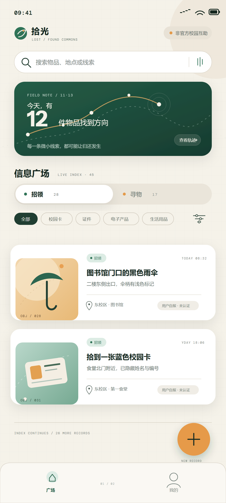
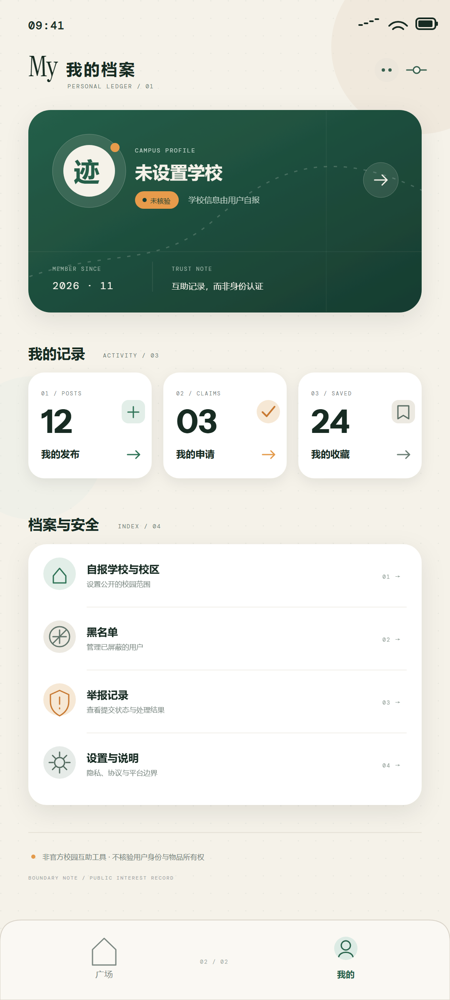
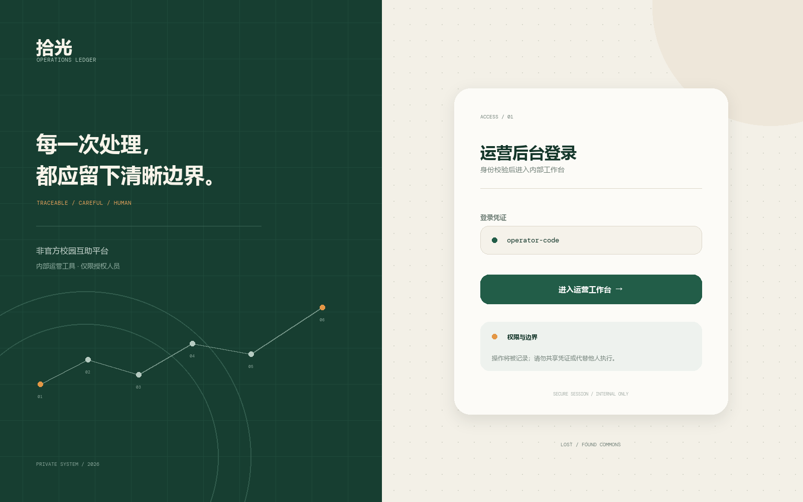
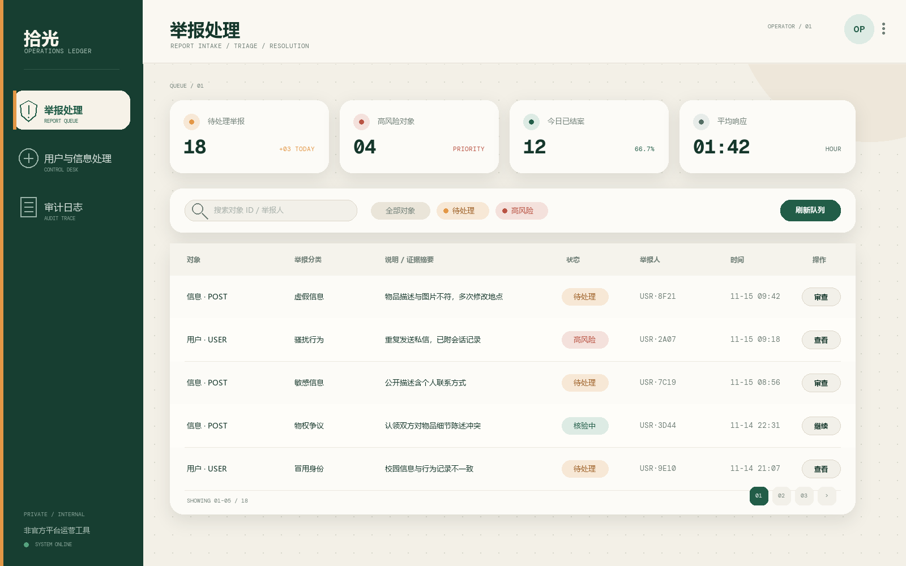
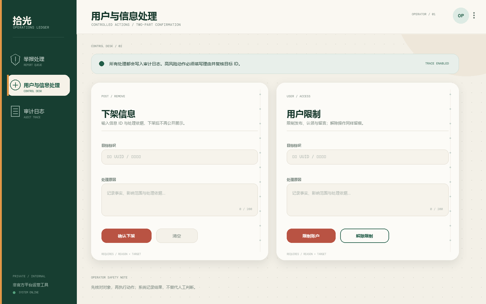
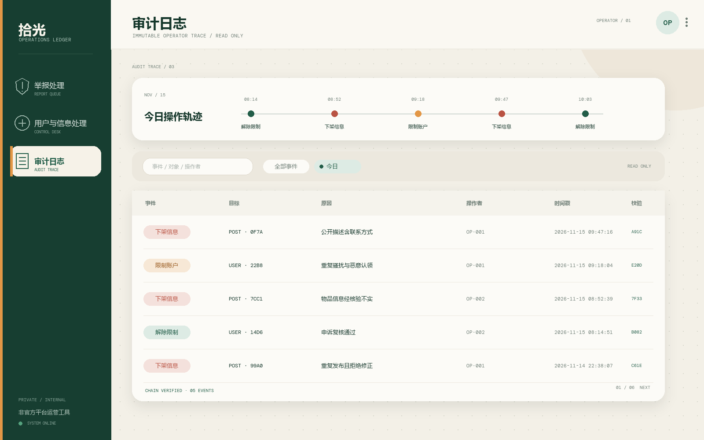
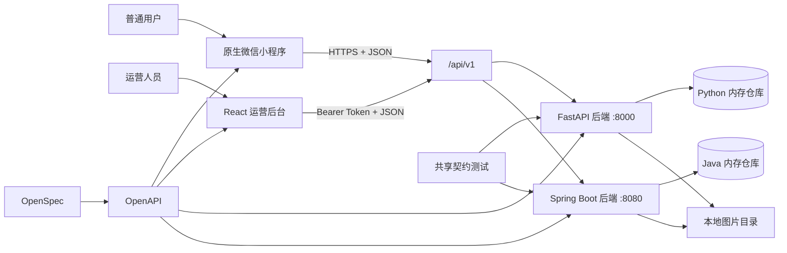
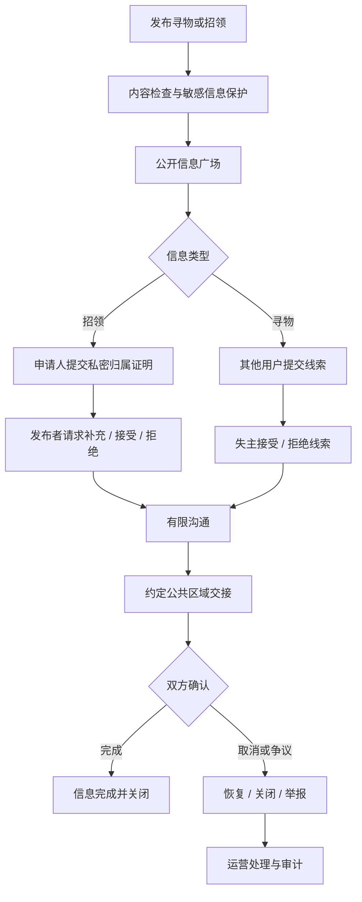
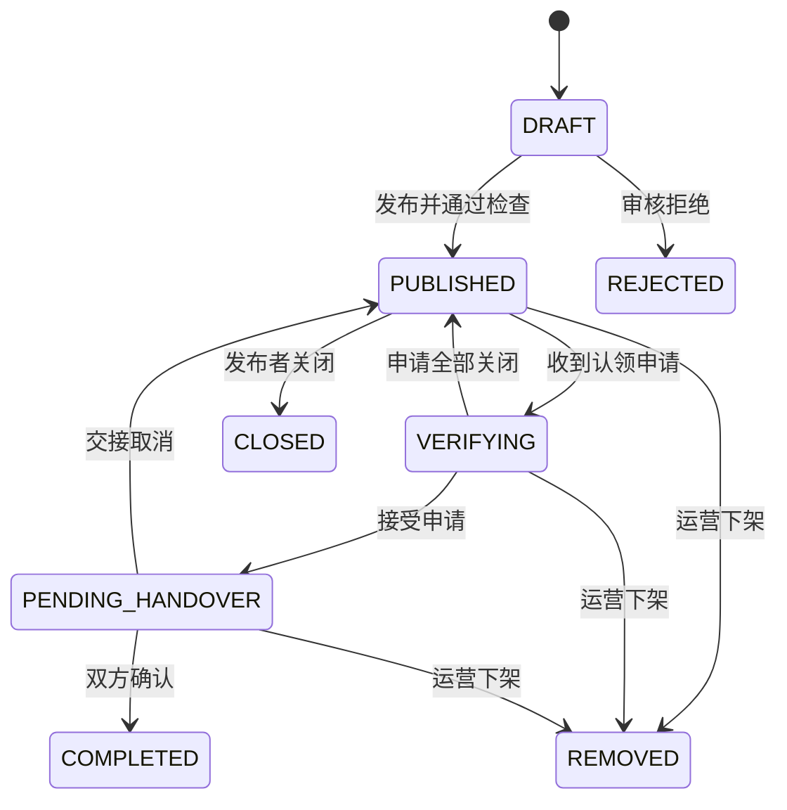

# 拾光 · 校园失物招领互助平台

> 非官方校园互助工具 · 原生微信小程序 + React 运营后台 + Java / Python 双后端

拾光用于帮助校园及周边用户发布、检索、核验和交接遗失物品。项目通过隐藏关键归属特征、结构化认领、有限沟通、双方交接确认、举报与运营审计，降低信息分散、冒领、骚扰和隐私泄露风险。

本平台**不代表学校或校方机构，不核验真实校园身份，不裁决物品所有权，也不担保线下交接结果**。

文档更新：2026-11-15（Asia/Shanghai）

## 目录

- [界面预览](#界面预览)
- [项目现状](#项目现状)
- [系统架构](#系统架构)
- [仓库结构](#仓库结构)
- [技术栈](#技术栈)
- [快速开始](#快速开始)
- [配置说明](#配置说明)
- [微信小程序页面](#微信小程序页面)
- [运营后台页面](#运营后台页面)
- [API 概览](#api-概览)
- [状态与安全边界](#状态与安全边界)
- [测试与质量检查](#测试与质量检查)
- [OpenSpec 开发流程](#openspec-开发流程)
- [设计资产](#设计资产)
- [当前限制与生产化工作](#当前限制与生产化工作)
- [相关文档](#相关文档)

---

## 界面预览

### 微信小程序

<table>
  <tr>
    <td align="center"><strong>信息广场</strong></td>
    <td align="center"><strong>我的档案</strong></td>
  </tr>
  <tr>
    <td></td>
    <td></td>
  </tr>
</table>

### 运营管理后台

<table>
  <tr>
    <td align="center"><strong>运营账号登录</strong></td>
    <td align="center"><strong>举报处理</strong></td>
  </tr>
  <tr>
    <td></td>
    <td></td>
  </tr>
  <tr>
    <td align="center"><strong>用户与信息处理</strong></td>
    <td align="center"><strong>审计日志</strong></td>
  </tr>
  <tr>
    <td></td>
    <td></td>
  </tr>
</table>

> 设计图是视觉基准；实际页面使用真实组件、滚动区域、表单、表格和接口数据实现，不以整张设计图充当背景。

---

## 项目现状

当前仓库是一套可联调的 **walking skeleton**，覆盖客户端、管理端、公共 API 契约、双后端实现和共享契约测试。

| 项目 | 当前状态 |
|---|---|
| 微信小程序 | 原生 WXML / WXSS / TypeScript，18 个注册页面 |
| 运营后台 | React 18 + Vite + Ant Design，账号密码登录及 3 个运营工作页面 |
| Python 后端 | FastAPI，实现完整业务骨架，默认监听 `8000` |
| Java 后端 | Spring Boot 3.3 / Java 21，与 Python 版本保持契约等价，默认监听 `8080` |
| API 契约 | `openapi/product-api.yaml`，当前定义 43 个路径 |
| 共享契约 | 错误码、限流、内容审核规则和双后端黑盒测试 |
| 规格管理 | OpenSpec，已归档多项能力变更，当前仍有学校/校区实体变更在推进 |
| 数据持久化 | 当前两个后端均为内存存储；图片使用本地目录，不是生产数据库方案 |
| 微信登录 | 默认开启 mock；生产需配置真实 AppID、Secret，并关闭 mock |

### 已实现的核心能力

- 微信小程序会话、协议确认、用户资料和头像；
- 学校/校区目录、自报校园资料、校园邮箱核验；
- 寻物与招领草稿、图片、发布、搜索、详情、关闭；
- 认领申请、补充信息、接受与拒绝；
- 寻物线索提交与处理；
- 收藏、拉黑、举报及我的记录；
- 站内有限消息；
- 交接创建、双方确认和取消；
- 频率限制、内容审核和账户限制；
- 运营账号密码登录、举报处理、信息下架、账户限制/解除及审计日志；
- Java/Python 双实现共享同一 OpenAPI 与黑盒契约测试。

---

## 系统架构



Java 与 Python 后端是**可替换实现**，部署时选择其一。它们不应在同一请求链路中同时执行业务，也不共享运行时代码；共同事实源是 OpenAPI、共享错误码、审核规则、限流规则和契约测试。

### 关键业务闭环



---

## 仓库结构

```text
Lost&Found/
├── miniapp/                    # 原生微信小程序
│   ├── pages/                  # 18 个页面
│   ├── assets/                 # 页面图标与视觉资产
│   ├── types/api.ts            # 小程序端 API 类型
│   └── utils/                  # 请求、登录、格式化、状态文案
├── admin-web/                  # React 运营后台
│   ├── src/pages/              # Login / Reports / Actions / Audit
│   ├── src/components/         # 通用图标等组件
│   ├── src/api.ts              # Bearer Token 请求封装
│   └── src/styles.css          # Civic Ledger 设计系统
├── backend-python/             # FastAPI 等价实现
│   ├── app/                    # 账户、发布、认领、交接等模块
│   └── tests/                  # pytest 测试
├── backend-java/               # Spring Boot 等价实现
│   └── src/                    # 主代码与 JUnit / MockMvc 测试
├── openapi/
│   └── product-api.yaml        # 公共 API 事实源
├── contracts/
│   ├── error-codes.yaml        # 共享错误码
│   ├── moderation-rules.yaml   # 内容审核规则
│   ├── rate-limits.yaml        # 限流规则
│   └── run_contract_tests.py   # 双后端黑盒契约测试
├── openspec/                   # 行为规格、变更提案与归档
├── design/                     # 小程序和运营后台设计稿
├── PRODUCT.md                  # 产品定义、风险和长期方案
├── AGENTS.md                   # 开发代理及联调问题门禁
└── INTEGRATION_TEST_REPORT.md  # 联调缺陷、阻断与回归记录
```

---

## 技术栈

| 层级 | 技术 |
|---|---|
| 小程序 | 原生微信小程序、WXML、WXSS、TypeScript 5.5 |
| 运营后台 | React 18.3、Vite 5.4、Ant Design 5.21、TypeScript 5.5 |
| Python 后端 | Python 3.10+、FastAPI、Pydantic 2、PyJWT、bcrypt、HTTPX、pytest |
| Java 后端 | Java 21、Spring Boot 3.3.5、Spring MVC、Spring Security、Bean Validation、JJWT、JUnit 5、MockMvc |
| API / 规格 | OpenAPI 3、OpenSpec、YAML 共享契约 |
| 当前存储 | 进程内内存仓库、本地图片目录 |

---

## 快速开始

### 1. 环境要求

- Git；
- Node.js（建议 20 LTS；当前项目也可在较新版本运行）；
- 微信开发者工具和有效小程序 AppID；
- Python 3.10+ 与 [uv](https://docs.astral.sh/uv/)；
- 如选择 Java 后端：JDK 21 与 Maven；
- Windows 用户应注意仓库路径中的空格和 `&` 会影响 npm `.bin` shim。

### 2. 选择并启动一个后端

#### 方案 A：Python / FastAPI

```bash
cd backend-python
uv sync --extra test
uv run uvicorn app.main:app --host 0.0.0.0 --port 8000
```

默认 API 根地址：`http://127.0.0.1:8000/api/v1`

#### 方案 B：Java / Spring Boot

```bash
cd backend-java

# 确认 JAVA_HOME 指向 JDK 21
mvn spring-boot:run
```

默认 API 根地址：`http://127.0.0.1:8080/api/v1`

> 两个后端选一个即可。切换实现时，需要同步修改 `miniapp/config.ts` 与 `admin-web/src/config.ts` 中的 `API_BASE`。

### 3. 启动运营后台

```bash
cd admin-web
npm install
npm run dev
```

默认访问地址：`http://localhost:5173`

开发默认运营账号：

```text
username: admin
password: admin123
```

运营后台调用 `POST /api/v1/session/operator`，成功后将 token 保存在浏览器本地存储，并通过 `Authorization: Bearer <token>` 访问管理接口。

> `admin / admin123` 仅是开发默认值。生产环境必须通过环境变量覆盖，并使用足够强的密码。

### 4. 打开微信小程序

1. 在微信开发者工具中选择“导入项目”；
2. 项目目录选择 `miniapp/`；
3. 填入自己的有效小程序 AppID；
4. 本地联调时，在开发者工具中勾选“不校验合法域名”；
5. 确认 `miniapp/config.ts` 的 API 地址指向已启动的后端；
6. 开发 mock 登录可使用后端接受的 mock code；生产必须配置微信 AppID/Secret 并关闭 mock。

游客 AppID 不支持完整 TypeScript 编译、npm 构建、真机预览和上传，建议使用真实小程序 AppID。

---

## 配置说明

Java 与 Python 后端使用相同的核心环境变量。

| 环境变量 | 开发默认值 | 用途 |
|---|---|---|
| `WECHAT_MOCK` | `true` | 是否使用微信登录 mock；生产应设为 `false` |
| `WECHAT_APPID` | 空 | 微信小程序 AppID |
| `WECHAT_SECRET` | 空 | 微信小程序 Secret，不得提交到仓库 |
| `OPERATOR_USERNAME` | `admin` | 运营后台账号 |
| `OPERATOR_PASSWORD` | `admin123` | 运营后台密码；服务端以 bcrypt 方式校验 |
| `JWT_SECRET` | 开发用长字符串 | JWT HS256 密钥，生产必须替换且不少于 32 字节 |
| `JWT_TTL_SECONDS` | `7200` | 会话有效期，单位秒 |
| `CORS_ORIGINS` | `localhost:5173`、`127.0.0.1:5173` | 允许访问后端的运营后台来源，逗号分隔 |
| `CAMPUS_EMAIL_DOMAINS` | 空 | 校园邮箱域名白名单；空表示不限制 |
| `STORAGE_LOCAL_DIR` | `./data/media` | 当前图片本地存储目录 |

安全要求：

- 不要把 `.env`、微信 Secret、JWT 密钥或生产运营密码提交到版本库；
- 生产环境不要使用通配 CORS；
- 不要在日志中输出 token、密码、微信 `session_key`、私密核验特征或认领证据；
- 当前本地文件和内存仓库仅用于开发验证，不等同于生产持久化方案。

---

## 微信小程序页面

`miniapp/app.json` 当前注册 18 个页面：

| 页面 | 目录 | 主要能力 |
|---|---|---|
| 信息广场 | `pages/index` | 浏览、搜索、分类、首页统计 |
| 我的档案 | `pages/my` | 个人入口、活动计数、安全菜单 |
| 个人资料 | `pages/profile` | 昵称、头像等资料 |
| 首次进入 | `pages/welcome` | 非官方边界与进入引导 |
| 用户协议 | `pages/agreement` | 协议确认 |
| 发布 | `pages/publish` | 创建、编辑、图片和草稿 |
| 信息详情 | `pages/detail` | 公开详情、收藏、举报、认领/线索入口 |
| 认领申请 | `pages/claim-form` | 提交私密归属证明 |
| 申请管理 | `pages/claims` | 发布者处理申请 |
| 我的申请 | `pages/my-claims` | 查看本人认领申请 |
| 消息 | `pages/messages` | 有限沟通与结构化消息 |
| 交接 | `pages/handover` | 创建、确认或取消交接 |
| 我的发布 | `pages/my-posts` | 管理本人发布内容 |
| 收藏 | `pages/bookmarks` | 查看和取消收藏 |
| 学校与校区 | `pages/campus` | 目录、自报校园、邮箱核验 |
| 黑名单 | `pages/blocks` | 查看和解除拉黑 |
| 举报记录 | `pages/reports` | 查看本人举报及处理状态 |
| 设置 | `pages/settings` | 平台说明和账户相关入口 |

首页和“我的”页使用 `navigationStyle: custom` 与自定义底部导航；固定区、滚动区和安全区由真实布局实现。

---

## 运营后台页面

| 页面 | 能力 |
|---|---|
| 登录 | 运营账号密码认证，调用 `/session/operator` |
| 举报处理 | 加载举报、搜索和筛选、对信息类举报执行下架 |
| 用户与信息处理 | 按 ID 下架信息、限制账户、解除限制 |
| 审计日志 | 查看运营动作、目标、原因、操作者和时间 |

设计系统名为 **Civic Ledger**：暖纸灰承担长时间阅读，松绿表示可信与已确认，琥珀色表示待判断，矿物红仅用于高风险操作。详细哲学见 [`design/admin-web-civic-ledger-philosophy.md`](design/admin-web-civic-ledger-philosophy.md)。

---

## API 概览

所有接口以 `/api/v1` 为前缀，响应采用统一信封：

```json
{
  "data": {},
  "requestId": "0192...",
  "timestamp": "2026-11-15T08:00:00Z"
}
```

错误响应通过 `error.code` 暴露稳定业务错误码。完整定义以 [`openapi/product-api.yaml`](openapi/product-api.yaml) 和 [`contracts/error-codes.yaml`](contracts/error-codes.yaml) 为准。

### 会话与资料

| 方法 | 路径 | 说明 |
|---|---|---|
| POST | `/session/wechat` | 小程序微信 code 登录 |
| POST | `/session/operator` | 运营账号密码登录 |
| GET | `/me` | 当前账户 |
| POST | `/me/agreement` | 确认协议 |
| PUT | `/me/profile` | 修改用户资料 |
| POST | `/me/avatar` | 上传头像 |
| GET / PUT | `/me/campus-profile` | 查询或更新自报校园资料 |
| POST | `/me/campus-verification/email` | 发送校园邮箱验证码 |
| POST | `/me/campus-verification/email/confirm` | 确认校园邮箱验证码 |

### 学校与校区目录

| 方法 | 路径 | 说明 |
|---|---|---|
| GET | `/directory/schools` | 搜索学校目录 |
| GET / POST | `/directory/schools/{schoolId}/campuses` | 查询或提交校区 |
| POST | `/admin/campuses/{campusId}/review` | 运营审核校区 |

### 信息与图片

| 方法 | 路径 | 说明 |
|---|---|---|
| GET / POST | `/posts` | 搜索公开信息或创建草稿 |
| GET | `/stats` | 首页统计 |
| GET / PATCH | `/posts/{postId}` | 查询或编辑信息 |
| GET / POST | `/posts/{postId}/images` | 查询或上传图片 |
| DELETE | `/posts/{postId}/images/{imageId}` | 删除图片 |
| POST | `/posts/{postId}/publish` | 发布草稿 |
| POST | `/posts/{postId}/close` | 主动关闭信息 |
| GET | `/me/posts` | 我的发布 |

### 认领、线索与收藏

| 方法 | 路径 | 说明 |
|---|---|---|
| GET / POST | `/posts/{postId}/claims` | 查询或提交认领申请 |
| POST | `/claims/{claimId}/request-info` | 请求申请人补充信息 |
| POST | `/claims/{claimId}/accept` | 接受认领申请 |
| POST | `/claims/{claimId}/reject` | 拒绝认领申请 |
| GET | `/me/claims` | 我的申请 |
| GET / POST | `/posts/{postId}/clues` | 查询或提交线索 |
| POST | `/clues/{clueId}/decide` | 接受或拒绝线索 |
| POST / DELETE | `/posts/{postId}/bookmark` | 收藏或取消收藏 |
| GET | `/me/bookmarks` | 我的收藏 |

### 安全、沟通与交接

| 方法 | 路径 | 说明 |
|---|---|---|
| POST | `/reports` | 提交举报 |
| GET | `/reports/me` | 我的举报 |
| POST | `/blocks` | 创建拉黑关系 |
| DELETE | `/blocks/{userId}` | 解除拉黑 |
| GET | `/me/blocks` | 我的黑名单 |
| GET / POST | `/conversations/{conversationId}/messages` | 有限消息 |
| POST | `/handovers` | 创建交接 |
| POST | `/handovers/{handoverId}/confirm` | 确认交接 |
| POST | `/handovers/{handoverId}/cancel` | 取消交接 |

### 运营管理

| 方法 | 路径 | 说明 |
|---|---|---|
| GET | `/admin/reports` | 举报队列 |
| POST | `/admin/posts/{postId}/remove` | 下架信息 |
| POST | `/admin/users/{userId}/restrict` | 限制账户 |
| POST | `/admin/users/{userId}/unrestrict` | 解除限制 |
| GET | `/admin/audit-events` | 审计日志 |

---

## 状态与安全边界

### 信息生命周期



具体允许的状态以服务端实现和 OpenSpec 为准，客户端不得自行指定任意目标状态。

### 产品边界

- 自报学校不是校方认证；
- 微信登录不是实名或校园身份认证；
- 平台不公开手机号、微信号或私密核验答案；
- 平台不提供支付、悬赏、保证金、配送或物品保管；
- 线下交接应选择人员较多的公共区域，并可随时终止；
- 运营处理记录操作者、原因、时间和目标，但不代表平台裁定物品归属。

---

## 测试与质量检查

### Python 后端

```bash
cd backend-python
uv run --extra test python -m pytest -q
```

不要直接使用开发机全局 `python -m pytest`；旧版全局 Starlette/httpx 组合可能导致测试收集失败。

### Java 后端

```bash
cd backend-java
# JAVA_HOME 必须指向 JDK 21
mvn test
```

### 双后端契约测试

契约测试会分别启动 Java 与 Python 后端，对相同请求断言 HTTP 状态、响应结构、错误码、权限、状态迁移和敏感字段隐藏行为一致。

```bash
# 在仓库根目录执行；使用 backend-python 的隔离 Python
backend-python/.venv/Scripts/python.exe contracts/run_contract_tests.py
```

### 微信小程序类型检查

```bash
cd miniapp
npm install
node node_modules/typescript/bin/tsc --noEmit
```

### 运营后台构建

```bash
cd admin-web
npm install
node node_modules/typescript/bin/tsc --noEmit
node node_modules/vite/bin/vite.js build
```

> Windows 下仓库路径包含 `&` 时，`npm run build`、`npx` 或 `.bin` shim 可能把路径错误拆成多条命令。上述直接 Node 入口可绕过该问题。

### 联调问题门禁

本项目执行逐项联调：发现首个问题后立即暂停后续测试，完整记录证据，但联调代理不擅自修改实现；修复负责人明确说明修复完成后，先回归原问题，通过后才能继续原计划。详细规范见 [`AGENTS.md`](AGENTS.md)，当前记录见 [`INTEGRATION_TEST_REPORT.md`](INTEGRATION_TEST_REPORT.md)。

---

## OpenSpec 开发流程

行为变更采用规格驱动方式管理：

1. 在 `openspec/changes/<change-name>/proposal.md` 说明问题、范围和 breaking change；
2. 在 `design.md` 记录技术决策；
3. 在 `specs/` 中编写可验收行为；
4. 在 `tasks.md` 跟踪实现；
5. 更新公共 OpenAPI 和共享契约；
6. Java、Python、客户端和管理端分别实现；
7. 双后端契约测试及端到端联调通过后归档到 `openspec/changes/archive/`。

当前未归档变更：`school-campus-entities`。它仍属于进行中的规格工作，不应被当作已完成发布说明。

---

## 设计资产

| 文件 | 说明 |
|---|---|
| `design/miniapp-home-concept.png` | 小程序信息广场 1080 × 2400 设计基准 |
| `design/miniapp-my-concept.png` | 小程序“我的档案”1080 × 2400 设计基准 |
| `design/admin-web/*.png` | 运营后台 1600 × 1000 多页面设计基准 |
| `design/trace-atlas-philosophy.md` | 小程序首页视觉哲学 |
| `design/quiet-ledger-philosophy.md` | 小程序个人档案视觉哲学 |
| `design/admin-web-civic-ledger-philosophy.md` | 运营后台视觉哲学 |

视觉实现应遵循以下原则：

- 设计图是视觉契约，不自行重新设计；
- 使用真实组件和真实交互区，不通过整图背景伪造页面；
- 图标使用 SVG/PNG 或可访问的矢量组件，不用 emoji 冒充图标；
- 固定区、滚动区与安全区真实实现；
- 示例数字不硬编码为真实业务数据；
- 修改样式时保留 TypeScript 请求逻辑和事件绑定；
- 浏览器或模拟器截图验收通过前，不宣称像素级完成。

---

## 当前限制与生产化工作

以下是已确认的当前限制，不应与 `PRODUCT.md` 中的目标方案混淆：

1. **没有生产数据库**：当前使用进程内内存仓库，重启会丢失业务数据；
2. **图片是本地文件**：尚未接入对象存储、CDN、病毒扫描或生产图片审核；
3. **微信登录默认 mock**：生产必须接入微信 `code2session` 并保护 `session_key`；
4. **运营账号是单一环境变量账号**：尚未实现多运营人员、角色权限、MFA 和账号生命周期；
5. **邮件验证码属于开发验证能力**：生产需要接入真实邮件服务、验证码存储和重放保护；
6. **缺少正式部署方案**：仓库当前没有完整数据库迁移、容器编排、反向代理、TLS 和备份恢复配置；
7. **视觉验收仍可能受本机工具影响**：详细阻断和未验证范围以联调报告为准；
8. **学校/校区实体仍有活跃变更**：接口和行为应以最终归档规格为准。

生产化优先级建议：持久化数据库与迁移 → 密钥管理 → 对象存储 → 真实微信/邮件服务 → 运营权限与 MFA → 可观测性 → 备份恢复与安全测试。

---

## 相关文档

- [产品与技术方案](PRODUCT.md)
- [前后端联调与问题记录](INTEGRATION_TEST_REPORT.md)
- [开发代理协作规范](AGENTS.md)
- [微信小程序说明](miniapp/README.md)
- [运营后台说明](admin-web/README.md)
- [Python 后端说明](backend-python/README.md)
- [Java 后端说明](backend-java/README.md)
- [公共 OpenAPI](openapi/product-api.yaml)
- [共享错误码](contracts/error-codes.yaml)
- [内容审核规则](contracts/moderation-rules.yaml)
- [限流规则](contracts/rate-limits.yaml)

---

## 免责声明

拾光是非官方校园互助项目。平台提供信息组织、有限沟通和流程记录能力，不验证用户真实身份或物品所有权，不替代学校、警方、保卫处、失物中心或法律程序。证件、银行卡、高价值物品及存在人身或财产风险的情况，应优先联系相应机构处理。
